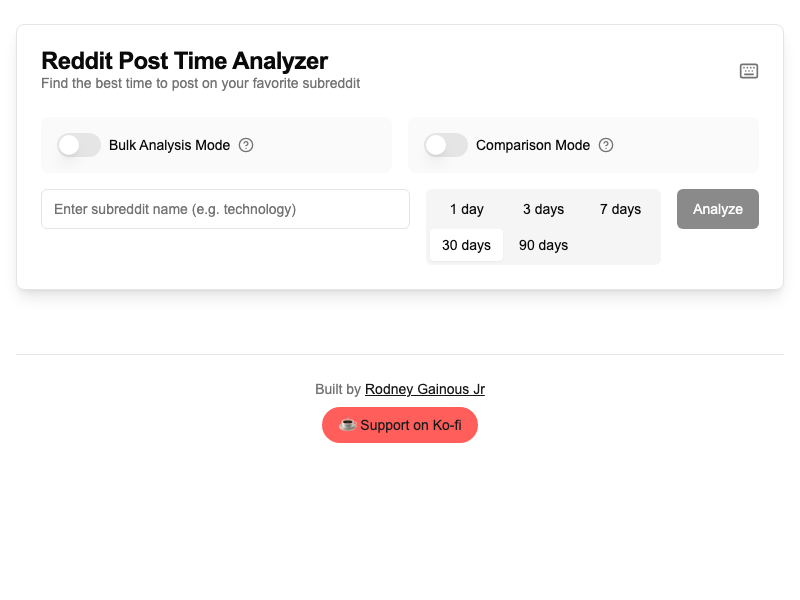
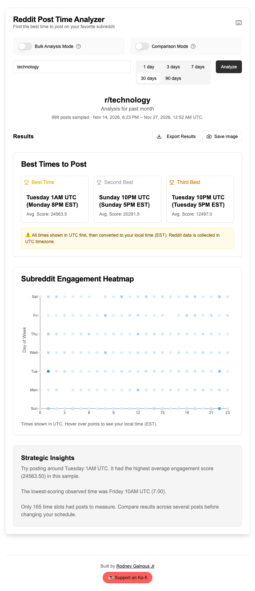

# Reddit Post Time Analyzer

**See which posting times had the highest average engagement in a sample of recent subreddit posts.**

This tool groups recent subreddit posts by when they were published and ranks those time slots by average engagement (Reddit post score plus comment count). It shows the results in a heatmap, a ranked list, and a summary.

## Current product screenshots

Captured from the live app on November 26, 2026.





---

## 🔍 What It Does

- Choose a range of **1, 3, 7, 30, or 90 days**. The default backend samples recent posts within the requested range.
- See average engagement (Reddit post score plus comment count) in a heatmap and ranked list of up to three time slots. The list and heatmap tooltips show UTC and your local time.
- Read a summary of the highest-scoring time slot for a single subreddit. The summary also gives the lowest-scoring slot when its score differs from the highest.
- Use subreddit suggestions while typing or enable Comparison Mode to compare analyses side by side.
- Download single-subreddit results as JSON, CSV, or text reports. Use **Save image** to download a PNG of single or bulk results.
- Analyze up to 10 subreddits at once and export successful bulk results as JSON or CSV.
- See the sample count, oldest and newest post times in UTC, and whether the listing was cut short when the backend includes sample details.

See the [changelog](CHANGELOG.md) for the history of these features.

## Product usage measurement

The production site uses Vercel Web Analytics for aggregate page views and unique visitors. The app does not add an account, cookie, or personal identifier for this measurement. The analytics script is rendered by the app layout, and Web Analytics is enabled for the Vercel project.

To read weekly usage, open the `reddit-analytics` project in Vercel, select **Analytics**, and set the date range to the last 7 days. Read **Visitors** as weekly active visitors. Vercel's unique visitor count is an estimate based on privacy-preserving signals, so treat it as a trend rather than an exact install count. To compare weeks, read the same seven-day range one week earlier and calculate `(current visitors - previous visitors) / previous visitors`.

This measures visits to the web app, not installs. For a comparable weekly active number, use the same Vercel project and seven-day window each week. Page views are not a count of analyses; one visitor may make several requests.

---

## 🛠 Tech Stack

- Next.js (App Router)
- TypeScript
- Tailwind CSS
- Recharts (for visualizations)
- Vercel (frontend deployment)
- Express + Node.js *(backend via Render)*

---

## 📦 Bulk Analysis Feature

Analyze multiple subreddits at once! Switch to bulk mode and enter subreddits using any of these formats:

```
# Comma separated
technology, programming, reactjs

# Line separated
technology
programming
reactjs

# Bullet points
• technology
• programming
• reactjs

# Dashes
- technology
- programming
- reactjs

# Mixed formats work too!
technology, programming
- reactjs
• nextjs
```

**Features:**
- Up to 10 subreddits per request
- Estimated progress while the batch runs
- Tabbed interface for easy browsing between results
- Accepts subreddit names with an optional `r/` or `/r/` prefix. Names may use only letters, numbers, and underscores. The form splits input on commas, spaces, newlines, and bullet markers, including hyphens. If a resulting entry contains invalid characters, its tab shows "Invalid subreddit name".
- JSON export and separate CSV exports for best times and heatmap data

---

## Empty results and errors

- If a subreddit has no posts to analyze, check its spelling. Try a longer date range.
- When a batch returns individual failures, the affected subreddit tabs show the errors alongside the successful results. The export menu is available when at least one analysis succeeds.
- If the analyzer says the backend is waking up, wait a few seconds and select **Retry**. In bulk mode, this retries the whole batch.

## 🚀 Get Started

Clone the frontend and run it locally:

```bash
git clone https://github.com/rodneyg/reddit-analytics.git
cd reddit-analytics
npm ci --legacy-peer-deps
npm run dev
```

Next.js prints the local URL when it starts.

The single and bulk API routes use the hosted analyzer backend on Render by default. Frontend setup does not require Reddit credentials.

To run your own backend, clone the [backend repository](https://github.com/rodneyg/reddit-analyzer-backend). In that checkout, set `REDDIT_CLIENT_ID`, `REDDIT_CLIENT_SECRET`, `REDDIT_USERNAME`, and `REDDIT_PASSWORD` in a backend `.env` file, then run:

```bash
npm ci
npm run build
npm start
```

The backend listens on port 3001 by default. You can set `PORT` in the backend environment. In the frontend, change the URL in `lib/analyzer-backend.ts` to point to your backend's `/analyze` endpoint.

## 🧠 How It Works

- The frontend requests up to 100 posts per page. The default backend reads up to 10 pages per subreddit and stops early if it reaches the date cutoff, the end of the listing, or Reddit reports that its rate allowance is exhausted.
- The default backend groups those posts by UTC day and hour, then averages the engagement score within each group.
- The browser displays the heatmap and the three highest-scoring time slots when available. Single-subreddit analysis also summarizes the observed scores.

## 🙌 Credits

Built by Rodney Gainous Jr

If you found it useful:  
☕ [Support on Ko-fi](https://ko-fi.com/rg2official)

⸻

## 📄 License

MIT — use it, remix it, build on it. Attribution appreciated.

---
